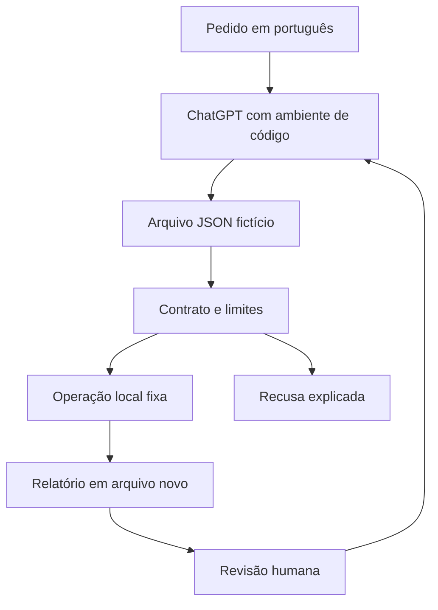

# IT-Tools no ecossistema Radar — auditoria e adaptação

Data: **21/10/2026**, America/Sao_Paulo. Responsável pelo projeto: Carlos Felipe. Origem avaliada: [CorentinTh/it-tools](https://github.com/CorentinTh/it-tools/tree/d505845f918e946ec300af7b36efc107e2f66e9e), commit `d505845f918e946ec300af7b36efc107e2f66e9e`. Escopo: código público, testes locais sintéticos e novo laboratório para ChatGPT; nenhuma implantação ou conexão financeira.

## 1. Executive Summary

**C — EXTRACT.** O IT-Tools é uma SPA madura de utilitários locais, com 86 registros em dez categorias. Aproveitar seus padrões de catálogo e funções independentes faz sentido; transportar integralmente sua interface Vue e ferramentas de credenciais para uma conversa acrescentaria complexidade e exposição desnecessárias.

Foi criado o repositório público autoral [radar-devtools-chatgpt](https://github.com/ofelipepeixoto/radar-devtools-chatgpt). A primeira fatia implementa **11 operações determinísticas**, usando a biblioteca padrão Python, exemplos fictícios, contratos estritos e saída em arquivo novo. Código e auditoria são propostas em branches independentes, com revisão humana pendente. [PR #1 — implementação](https://github.com/ofelipepeixoto/radar-devtools-chatgpt/pull/1). Não se apresenta como substituto das 86 ferramentas upstream.

## 2. GitHub Ecosystem Context

O inventário inicial encontrou **66 repositórios próprios acessíveis: 50 públicos e 16 privados**, antes de criar este novo repositório. A paginação foi conferida. A contagem não cobre todas as organizações/contas do usuário. [Mapa completo público](ecosystem.md) e [inventário](../evidence/ecosystem-public-inventory.json). Identidades dos privados não são publicadas.

Foram aprofundados oito projetos relacionados. Workbench já possui scanner e revisão; Integration Hub governa chamadas externas; Evidence Kit tem contratos próprios de evidência; Code Atlas cobre exploração de código; Marketing Copilot já demonstra o desenho arquivos → cálculo → conversa; Capital mantém domínio financeiro separado. Algumas `main` são bootstrap, com implementação em PR: não inferir ausência de código por linguagem nula nos metadados.

## 3. Repository Overview

[CODE VERIFIED] Vue 3, TypeScript, Vite, Pinia, Vue Router, Naive UI e UnoCSS; PWA e hospedagem estática. Entradas: `src/main.ts`, `src/tools/index.ts`, componentes por ferramenta e serviços puros. Manifesto: 67 dependências runtime e 43 de desenvolvimento; lock pnpm. O repositório declara pnpm9.11; a execução local usou Node24 e pnpm disponível11.25, com lock congelado e scripts de instalação desativados. [Catálogo](upstream-tools-catalog.md).

## 4. Evidence Level

| Classe | Evidência nesta execução |
| --- | --- |
| [CODE VERIFIED] | Código, licença, catálogo, configurações de build/PWA, persistência e serviços focais lidos no SHA acima. |
| [TEST VERIFIED] | 138 testes unitários upstream; lint, tipos e build; oito comportamentos reproduzidos; nove testes de patches candidatos. Testes da adaptação registrados separadamente em sua branch. |
| [DOC CLAIM] | Escala, segurança ou funcionalidades mencionadas em READMEs não exercitadas não são certificadas. |
| [INFERENCE] | Encaixe no ecossistema, hipóteses de produto e limites de escala. |
| [NOT VERIFIED] | E2E em navegador, Docker, tráfego do site publicado, carga, Windows, produção e segundo operador no ChatGPT. |

Foram **listados** 183 casos E2E em 26 arquivos; eles não foram executados. Logs resumidos estão em `evidence/upstream-checks.log`; detalhes em [qualidade](upstream-quality.md). A presença de testes não demonstra cobertura de todos os caminhos.

## 5. License & IP

[CODE VERIFIED] `LICENSE` contém **GPLv3**; `package.json` declara `GNU GPLv3`. Preservar atribuição, texto da licença e requisitos aplicáveis ao distribuir código derivado. O laboratório novo também adota **GPL-3.0-only**, por decisão de distribuição. Seu motor Python é original; não incorpora interface, marcas ou assets Vue. Os dois serviços candidatos de auditoria são derivados do upstream e estão identificados como tais. A cópia integral da licença está no repositório. Não se afirma que a auditoria seja parecer jurídico. Referência primária: [licença no SHA auditado](https://github.com/CorentinTh/it-tools/blob/d505845f918e946ec300af7b36efc107e2f66e9e/LICENSE).

## 6. Architecture Review

A arquitetura upstream separa catálogo, componentes Vue, funções de transformação e infraestrutura estática. A escolha Vue está coerente com uma coleção interativa; não há motivo para migrá-la integralmente por preferência Python. Algumas entradas permanecem em localStorage ou parâmetros de rota. Portanto, “local no navegador” não implica “sem retenção”. Plausible existe, desabilitado por padrão; telemetria no site publicado não foi observada.

O novo pacote separa parsing/limites, operações puras e adaptador de arquivos. A conversa escolhe uma operação permitida; não fornece expressão arbitrária, shell, caminho interno de função ou SQL executável.

## 7. Code Quality

Upstream: **138 testes em 33 arquivos aprovados**, checagem de tipos e build aprovados; lint sem erro e com três avisos UnoCSS. O build modificou arquivo gerado, restaurado ao final; fontes e lock ficaram limpos. Foram encontrados defeitos de correção não cobertos pela suíte: CSV com escapes inadequados e captura opcional de regex descartando match válido.

Adaptação: limites centralizados, nomes de operação fixos, erros estáveis sem ecoar dados, testes positivos e negativos, documentação e exemplos reproduzíveis. JSON usa Decimal, preservando números grandes sem arredondamento binário. A adaptação passou em **69 testes locais: 38 do motor, 10 do CLI e 21 independentes**, além dos11 exemplos válidos e da recusa de data sem fuso. Compilação e build de wheel passaram. A [CI remota da PR de implementação](https://github.com/ofelipepeixoto/radar-devtools-chatgpt/actions/runs/39657278239) passou em Python3.11/3.12, incluindo testes, exemplos e empacotamento.

## 8. Security Audit

[Achados detalhados, condições, contraprovas e evidências](upstream-findings.md). Oito reproduções se agrupam em seis causas; não representam oito vulnerabilidades remotas.

| ID | Comportamento confirmado | Severidade contextual / limite |
| --- | --- | --- |
| IT-01 | Token depende de Math.random; alfabeto omite N/n. | Média se saída for adotada como credencial; não foi quebrada conta real. |
| IT-02 | CSV usa escapes de aspas incorretos e cabeçalhos não protegidos. | Média de integridade; patch candidato e cinco testes focais. |
| IT-03 | Célula `=1+1` permanece fórmula na exportação. | Baixa condicional; planilha não aberta, execução não comprovada. |
| IT-04 | Captura opcional sem valor lança erro e UI mostra ausência de match. | Baixa de correção; quatro testes focais no candidato. |
| IT-05 | Regex arbitrária roda sincronamente sem orçamento. | Baixa/local; ensaio interrompido por limite externo de 200ms, sem benchmark de escala. |
| IT-06 | Texto customizado vira markup no SVG exportado. | Baixa condicional; preview em img é contraprova contra alegação de XSS automático. |

SCA: **192 registros de advisories, 162 GHSA distintos**; 114 registros têm caminho runtime (96 GHSA distintos), 78 são somente desenvolvimento. Esses números são correspondências de versões, não exploração comprovada. O resumo mantém as contagens e `evidence/upstream-advisories.csv` registra os IDs e versões por linha (arquivo gerado pelo audit). Fontes primárias conferidas: [DOMPurify GHSA-mmhx-hmjr-r674](https://github.com/cure53/DOMPurify/security/advisories/GHSA-mmhx-hmjr-r674) e [Vite GHSA-vg6x-rcgg-rjx6](https://github.com/vitejs/vite/security/advisories/GHSA-vg6x-rcgg-rjx6). A primeira correção histórica de um advisory não é recomendação suficiente de versão atual.

Não se comprovou exfiltração, XSS no site ou comprometimento de credencial. A adaptação exclui geração de chaves, seeds, senhas, JWT, expressões regex arbitrárias e renderização HTML/SVG; não importa a árvore de dependências upstream.

## 9. Performance

O build produziu aproximadamente 14MiB. Dois bundles grandes, de MAC lookup e text diff, excederam o limite de precache; sucesso da PWA não prova cobertura offline completa. Regex síncrona é gargalo local confirmado sob entrada sintética. Não houve teste de carga.

Adaptação limita arquivo a256KiB, cada argumento textual a64KiB UTF-8, estruturas JSON a32 níveis/10.000 nós, diferença a200 alterações e saída a1MiB. Limites reduzem consumo, mas não são benchmark nem isolamento de processo. Não expor a função diretamente à rede sem nova avaliação.

## 10. Scalability

| Cenário | Avaliação |
| --- | --- |
| Local | Funções do laboratório executadas com exemplos e testes sintéticos. |
| 10 usuários | Cópias independentes locais são hipótese simples; colaboração/controle central não implementados. |
| 100/1.000/10.000 | Nenhum benchmark, SLO ou custo de serviço foi medido. Hospedagem estática upstream e execução no cliente não equivalem a SaaS multiusuário. |
| Multi-tenant | Não há serviço de tenants no laboratório. Se criado, exigir identidade confiável, isolamento, quotas e retenção explícita. |

## 11. AI Engineering

LLM não agrega precisão à codificação Base64 ou SHA-256. Código executa; ChatGPT explica. Nomes e argumentos têm allowlist e contratos. Sem tool calling remoto, modelo pago, token meter ou custo de API incorporado. Não estimar economia financeira sem medir tempo do operador e planos reais. Prompt de avaliação exige declarar arquivos lidos, comando, resultado e limitação; não pode dizer que executou sem ferramenta de código.

## 12. Agentic AI

O produto é determinístico. Não precisa planner, memória, múltiplos agentes ou autonomia de rede. Delegação de auditoria nesta construção não cria agentes dentro do software entregue. Caso futuro exija seleção dinâmica, a escolha do modelo continuará proposta e o servidor deverá validar operação, dados e autoridade.

## 13. RAG

Não há necessidade de embeddings, chunking ou banco vetorial para onze nomes de operação e um contrato curto. Busca de conhecimento e citação já têm projetos no ecossistema. Não confundir um catálogo de funções com pipeline RAG.

## 14. MCP Opportunities

**WATCH.** Uma adaptação remota poderá aproveitar o Integration Hub existente, se vários consumidores precisarem do mesmo serviço. Antes: autenticação, identidade de tenant, tamanho, orçamento, timeout, retenção e testes de contrato. Nenhum MCP ou endpoint foi instalado, autenticado ou conectado nesta entrega. Para uso local, o pacote e arquivos resolvem o caso sem serviço permanente.

## 15. n8n Opportunities

**EXPERIMENT posterior.** Receber arquivo consentido → validar → executar função fixa → apresentar prévia → revisão humana. n8n deve orquestrar; parsing, hash e limites permanecem no código. Não usar Execute Command com texto livre do usuário nem transportar credenciais de conectores nos exemplos. Nenhum workflow foi criado/importado/ativado ou conectado à VPS.

## 16. Infrastructure

Python3.11+; adaptador CLI exige Linux/POSIX para percorrer diretórios com nofollow e criar saída exclusiva0600. Biblioteca de funções pode ter maior portabilidade; Windows não foi homologado. Sem Docker, banco, Redis, Supabase ou portas novas. Upstream Docker usa tags flutuantes e não define usuário não-root/healthcheck; camada TLS/headers externa não foi examinada. Não confundir esses pontos com incidente confirmado.

## 17. Observability

Relatório novo inclui operação, versão do motor, SHA-256 dos bytes da entrada, resultado e limitações. stdout contém somente status/operação/hash; erros não repetem conteúdo. **O arquivo de resultado pode conter os dados transformados**: não é mecanismo de anonimização. Hash não autentica origem ou aprovação. Falha de disco durante gravação pode deixar arquivo parcial; não retorna sucesso, e nova tentativa deve usar caminho novo. Não há coleta de logs ou acompanhamento contínuo.

## 18. Stack Decision Matrix

| Tecnologia | Estado | Decisão | Justificativa |
| --- | --- | --- | --- |
| Vue/TS/Vite upstream | Existente | Manter se adotar app completo | Boa adequação à interface; corrigir dependências antes de distribuição operacional. |
| Python stdlib | Nova adaptação | ADOPT | Operações locais, fácil execução no ambiente de código, zero dependência runtime de terceiros. |
| JSON/Markdown | Contratos/documentos | ADOPT | Inspeção humana, exemplos e rastreabilidade simples. |
| GitHub Actions | Validação | ADOPT | Testes, exemplos e build em Python3.11/3.12; ações fixadas por SHA, permissão contents:read. |
| LLM/API paga | Ausente | Não adicionar ao motor | Não melhora cálculo exato nem precisa credencial. |
| RAG/Redis/Supabase/Kafka | Ausentes | Não adicionar | Volume/estado atual não justificam manutenção. |
| MCP/n8n/Worker web | Potenciais | WATCH | Só quando benefício e consumidor forem confirmados. |

## 19. GitHub Integration Map

| Componente de referência | Destino | Método/estado |
| --- | --- | --- |
| Catálogo e funções puras | radar-devtools-chatgpt | NEW REPOSITORY: recorte autoral implementado. |
| Hash/JSON de evidência | radar-evidence-kit | Não declarar compatibilidade automática; sem alteração. |
| Governança de chamada remota | radar-integration-hub | EXTEND EXISTING REPO futuro, sem conexão. |
| Revisão de código/patch | security-workbench | Referência para achados, sem alterar scanner. |
| Rotina de arquivos | Repositório existente de n8n | N8N WORKFLOW somente após escopo e homologação. |
| Seed/chave/assinatura | Nenhum | DO NOT ADOPT no chat; domínio financeiro separado. |

## 20. Product Opportunities

Hipótese principal: ferramenta interna da Help Mídias para revisar exemplos de payloads e configurações sem colar dados em vários sites. ICP: operador técnico em formação e revisor de automações. Proposta de valor: função exata + explicação simples + origem rastreável. MVP é o pacote desta entrega; diferenciação reside no contrato, casos de recusa e encaixe nos fluxos de revisão, não nos algoritmos universais.

Preço não validado. Melhor começar como apoio interno incluído no serviço; hipótese de produto pago depende de uso repetido e ganho mensurável. Custo incremental do motor é CPU/armazenamento do ambiente existente, sem assinatura nova contratada; custo do ChatGPT/hospedagem é separado. Complexidade atual baixa; SaaS, white label e autenticação aumentariam custo. Não há moat comprovado em Base64 ou hash.

## 21. Architecture 2.0

Nenhuma conexão externa está implícita no diagrama. Conteúdo do arquivo é dado, não instrução para executar shell, instalar plugin ou alterar autoridade.

## 22. Code Improvements

Upstream: candidatos focais de CSV/capturas regex em `evidence/upstream-candidates/upstream-correctness.patch`, com nove testes. Não resolvem fórmulas em planilhas, CSPRNG, SVG ou dependências. São propostas locais, não correções aceitas/aplicadas ao upstream.

Adaptação: parsing JSON rejeita duplicatas, NaN/Infinity, Unicode inválido e estrutura excessiva; valida nome/argumentos exatos; CIDR não enumera hosts; URL não faz DNS/HTTP; data exige fuso; Base64 exige UTF-8 canônico. CLI recusa links simbólicos, caminhos com travessia, FIFOs e sobrescrita. Revisão independente apontou Unicode inválido dentro do JSON e robustez do caminho contendo NUL; correções incluídas antes da publicação.

## 23. Technical Scorecard

Notas são julgamento deste recorte auditado, não certificação, ranking ou nota de produção. Segurança/alcance não derivam de média. Ausência intencional de IA é informada, sem forçar componentes.

| Dimensão upstream | Nota /10 | Evidência e limite |
| --- | --- | --- |
| Architecture | 8 | Catálogo/rotas/funções bem separados; retenção varia por ferramenta. |
| Code Quality | 7 | Tipos/lint/testes passam; defeitos CSV/regex confirmados. |
| Security | 4 | Math.random, entradas arbitrárias e lock com advisories; sem exploração do site. |
| Reliability | 6 | 138 testes; correção silenciosa de regex e precache parcial reduzem confiança. |
| Performance | 6 | Imports por ferramenta; bundles grandes e regex bloqueante; sem benchmark. |
| Scalability | 5 | SPA estática reduz backend; escala/SaaS não testados. |
| Testing | 7 | Unit e E2E existentes; E2E não executado nesta auditoria. |
| Documentation | 7 | README/setup/catálogo claros; limites de segredos/retencão poderiam ser mais explícitos. |
| DevOps | 6 | CI e build funcionam; tags Docker/ações e dependências exigem atualização. |
| AI Engineering | 0 | Não oferece pipeline de IA; recurso desnecessário para sua função. |
| Agentic Architecture | 0 | Sem agente; escolha adequada, não defeito arquitetural. |
| Innovation | 6 | Boa agregação/UX; operações padronizadas com pouca diferenciação algorítmica. |
| Maintainability | 6 | Organização modular; grafo de dependências amplo e antigo no lock. |
| Fit com GitHub | 8 | Complemento geral ausente, sem duplicar governança/evidência. |
| Fit com Help Mídias | 7 | Utilidade plausível para payloads; uso real ainda não medido. |
| Product Potential | 5 | Hipótese interna clara; demanda/preço/retenção não demonstrados. |

## 24. Adoption Decision

**C — EXTRACT**, principal. Extrair padrões conceituais de catálogo e operação local; implementar recorte próprio para conversa. Secundária E — REIMPLEMENT para as onze funções do novo motor. Não escolher F — ADAPT completo nem G — PRODUCTIZE sem revisão das dependências, UX/privacidade e validação de demanda. Não é fork completo; autoria de terceiros e licença permanecem explícitas.

## 25. Build vs Adopt vs Buy

| Caminho | Tempo/custo relativo | Controle/manutenção | Decisão |
| --- | --- | --- | --- |
| BUILD pequeno | Baixo recorte, sem assinatura adicional | Contrato simples; responsabilidade por testes próprios | Escolhido para ChatGPT. |
| ADOPT IT-Tools | UI pronta e abrangente | GPL, dependências, updates e hardening | Boa alternativa se precisar das86 interfaces; pendente de correções. |
| BUY SaaS | Setup potencialmente rápido | Retenção, limites, conta/preço/lock-in precisam revisão | Não contratado; sem necessidade demonstrada. |

Estimativas relativas, não orçamento ou promessa de prazo. Não foi feita pesquisa exaustiva de fornecedores/preços.

## 26. Repository Strategy

Novo repositório público do proprietário, com histórico inicial próprio e GPL. `main` permanece bootstrap. Duas branches/PRs independentes: `feat/local-utilities` reúne motor, testes, guia e CI; `docs/it-tools-audit` reúne relatório, mapa público, evidências e patches candidatos. Cada PR pode ser revisada sem incorporar a outra. Não copiar READMEs de repositórios privados nem publicar inventário privado completo.

## 27. Implementation Roadmap

| Fase | Estado/critério |
| --- | --- |
| 0 Due diligence | Código/licença/mapa/testes auditados no SHA fixado. |
| 1 Proof of concept | Onze funções e exemplos locais implementados. |
| 2 Hardening | Contratos, limites, nofollow/exclusão e revisão independente implementados; revisão humana pendente. |
| 3 Integration | Guia ChatGPT pronto; homologação por segundo operador pendente; sem conexão remota. |
| 4 Observability | Relatório local/hash implementados; não há serviço monitorado. |
| 5 Evals | Testes determinísticos executados; avaliação de utilidade por usuário ainda pendente. |
| 6 Production | Não autorizado/realizado nesta etapa; depende de necessidade e revisão concreta. |
| 7 Scale | Só após métricas; sem carga ou promessa de capacidade. |
| 8 Productization | Demanda, retenção, preço e responsabilidade a validar. |

## 28. Priority Backlog

- **P0:** não houve achado crítico de aplicação demonstrado. Não converter severidade de dependência em incidente.
- **P1:** avaliar e atualizar grafo upstream, incluindo DOMPurify/Vite/cifras, antes de adotar distribuição operacional; remover uso de token não criptográfico como credencial.
- **P2:** revisar patches CSV/regex; isolamento de regex; escape de SVG; política de retenção e precache.
- **P3:** segundo operador no ChatGPT, métricas de utilidade; novas operações só após demanda e testes; MCP/n8n ficam condicionados.

## 29. Top 10 Actions

1. Revisar licença e atribuição na PR de código.
2. Executar o exemplo JSON e comparar resultado/arquivo/hash.
3. Executar comparação estrutural com bool versus número.
4. Confirmar recusa de data sem fuso.
5. Confirmar preservação da entrada e recusa de sobrescrita.
6. Homologar guia em conversa nova com segundo operador.
7. Revisar patch CSV e compatibilidade de importação.
8. Revisar captura opcional e separar isolamento de regex.
9. Fazer plano de atualização upstream com regressão completa/E2E antes de adoção operacional.
10. Medir utilidade e só então decidir integração remota ou ampliação do catálogo.

## 30. Final Technical Recommendation

Usaria o **Radar DevTools ChatGPT** como laboratório interno de funções exatas, complementar ao Workbench, Evidence Kit e Integration Hub. O valor para o usuário leigo está em pedir uma transformação em português e receber resultado executado, limitações e arquivo revisável. Para ampla interface web, manteria Vue upstream e corrigiria riscos antes de operar; não reescreveria todas as86 ferramentas.

Entrega: código autoral e auditoria em propostas separadas; testes/exemplos locais executados. Nada foi conectado a n8n, banco, VPS, carteira, API paga ou corretora. Não foi instalado automaticamente como Projeto/plugin/ferramenta nativa do ChatGPT. Homologação independente de uso e revisão humana permanecem pendentes. Os limites não certificam segurança universal nem execução em ambiente diferente.
